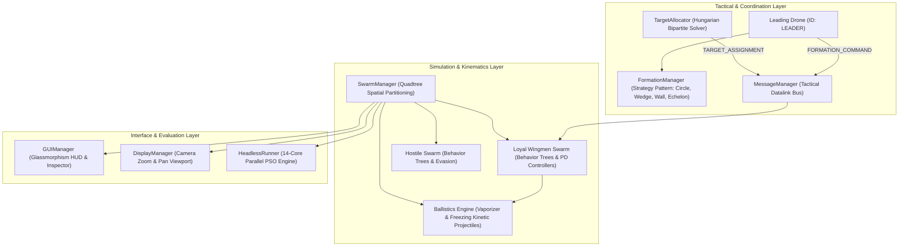

# Loyal Wingman (MUM-T) Autonomous Air Defense Simulator

[](https://www.python.org/downloads/)
[](https://pygame.org/)
[](file:///Users/lgr03/Documents/MDU_PhD/dev/simulators/Simulation_Wingman/headless_runner.py)
[](file:///Users/lgr03/Documents/MDU_PhD/dev/simulators/Simulation_Wingman/ROADMAP.md)

A high-throughput, discrete-time multi-agent aerospace combat simulator designed for research in **Manned-Unmanned Teaming (MUM-T)**, cooperative target allocation, dynamic formation geometries, tactical datalinks, and large-scale Monte Carlo optimization.

---

## 1. System Architecture & Overview

The simulation environment models a high-value manned aircraft (**Leading Drone**) escorted by autonomous **Loyal Wingmen** defending both the flight lead and a strategic ground infrastructure (**Protected Area**) against hostile, saturation kamikaze UAV swarms.



---

## 2. Key Research Capabilities

### Cooperative Target Allocation (Hungarian Algorithm)
- **Global Threat Prioritization:** Formulates an $N \times M$ global cost matrix considering drone-threat distance, threat proximity to the protected base, heading alignment, and weapon range.
- **Kuhn-Munkres Bipartite Optimization:** Solves the linear sum assignment problem via `scipy.optimize.linear_sum_assignment`, ensuring 100% unique 1-to-1 threat locks and eliminating redundant targeting.
- **Dynamic Role Specialization:** Defending drones dynamically transition between **`INTERCEPTOR`** (forward offensive sweep) and **`CLOSE_ESCORT`** (inner perimeter defense).

### Dynamic Tactical Formations (Strategy Pattern)
Polymorphic formation geometries computed analytically in real time and transmitted via datalink:
1. **Circle Formation (`CIRCLE`):** Radial equidistant orbit with multi-ring spacing for large escorts.
2. **Wedge Formation (`WEDGE`):** Symmetrical swept-back $45^\circ$ V-escort (Arrowhead) oriented along the flight lead's velocity vector.
3. **Wall Formation (`WALL`):** Linear defensive barrier perpendicular to threat ingress axis.
4. **Echelon Formation (`ECHELON`):** Stepped diagonal escort guarding the leader's flank.
- **Hungarian Re-formation Matching:** Minimizes total displacement $\min \sum \|\mathbf{p}_i - \mathbf{s}_j\|^2$ during formation transitions, completely preventing crossing trajectories and mid-air collisions.

### Physical Ballistics & Visual Tracers
- **Kinematic Projectiles:** Finite-velocity projectiles (`VaporizerBolt` railgun rounds at $850\text{ px/s}$ and `FreezingBolt` cryogenic pulses at $650\text{ px/s}$) with range limits and spatial Quadtree impact detection.
- **Lead Computing Gun Sight:** First-order predictive aiming compensating for target velocity: $\mathbf{p}_{\text{aim}} = \mathbf{p}_{\text{target}} + \mathbf{v}_{\text{target}} \cdot t_{\text{flight}}$.
- **Dynamic Visual Tracers:** Multi-segment gradient trailing wakes with glowing plasma cores; zero overhead in headless mode.

### Tactical Datalink Message Bus (`MessageManager`)
- **Decentralized Messaging:** Replaces direct memory mutation with structured `TacticalMessage` passing supporting point-to-point addressing and broadcast (`SWARM`/`ALL`).
- **Electronic Warfare (EW) & Latency Modeling:** Simulates communication delays and packet drop rates under adversarial jamming.

### Ultra-Fast Headless Execution (>8,000 FPS)
- Decoupled physical update loop executes over **8,000 frames per second** per CPU core.
- **Parallel Multi-Core PSO Runner:** Executes full Particle Swarm Optimization episodes across all CPU cores in parallel for rapid parameter sweeps.

---

## 3. Installation & Quickstart

### Prerequisites
- Python 3.10 or higher
- Conda or virtualenv

### Environment Setup
```bash
# Clone the repository
git clone git@github.com:luizgiacomossi/Simulation_Wingman.git
cd Simulation_Wingman

# Install dependencies
pip install pygame numpy scipy matplotlib
```

### Running the Simulator

#### 1. Interactive Graphical Mode (Pygame GUI with Tactical HUD)
```bash
python main.py
```

#### 2. Headless Parallel Optimization (Multi-Core PSO)
```bash
python headless_runner.py
```

#### 3. Running Test Suites & Benchmarks
```bash
# Test tactical datalink messaging
python test_message_manager.py

# Test physical ballistics & lead aiming
python test_ballistics.py

# Test dynamic formations & Hungarian re-formation
python test_formations.py

# Test cooperative Hungarian target allocation
python test_allocation.py
```

---

## 4. Interactive Keybindings & Controls

| Input | Action | Description |
| :---: | :---: | :--- |
| **`1`** | **Circle Formation** | Radial equidistant escort perimeter around leader |
| **`2`** | **Wedge Formation** | $45^\circ$ swept-back V-formation (Arrowhead) |
| **`3`** | **Wall Formation** | Linear defensive barrier shielding the base |
| **`4`** | **Echelon Formation** | Stepped diagonal flank protection |
| **`Space`** | **Pause / Resume** | Freezes physical updates while keeping GUI interactive |
| **`Left Click`** | **Command / Select** | Sets flight lead waypoint or selects UAV for Inspector |
| **`Right Click`** | **Spawn Threat** | Spawns hostile kamikaze drone at cursor location |
| **`C`** | **Center Camera** | Smoothly centers camera viewport on the Leading Drone |
| **`0` / `Home`** | **Reset Viewport** | Restores default camera zoom level and pan offset |
| **`D`** | **Debug Telemetry** | Toggles formation perimeter rings and sensor bounds |
| **`+` / `-`** | **Simulation Speed** | Accelerates or decelerates execution speed multiplier |
| **`P`** | **Plot Telemetry** | Renders iteration fitness curves and performance graphs |
| **`H`** | **Toggle HUD** | Toggles Glassmorphism HUD panels on/off |

---

## 5. Repository File Structure

```text
├── main.py                     # Simulator entrypoint, event loop & PSO runner
├── simulation.py               # Simulation controller, input processor & lifecycle
├── swarm_manager.py            # Swarm orchestrator, Quadtree spatial index & combat loop
├── vehicle.py                  # Kinematic vehicles: LeadingDrone, LoyalWingman, Kamikaze
├── target_allocator.py         # Hungarian Algorithm (Kuhn-Munkres) target allocation
├── formation.py                # Strategy Pattern: Circle, Wedge, Wall, Echelon generators
├── weapons.py                  # Kinematic Projectiles, Vaporizer & Freezing weapons
├── message_manager.py          # Decentralized tactical datalink bus & EW jamming
├── decision_making.py          # Behavior Tree logic & engagement rules for Loyal Wingmen
├── behavior_tree.py            # Modular Behavior Tree framework (Selectors, Sequences)
├── state_machine.py            # Finite State Machine controller for hostile drones
├── display_manager.py          # Viewport camera, auto screen detection, zoom & pan
├── gui_manager.py              # Glassmorphism Tactical HUD, Radar Minimap & Inspector
├── experiment_manager.py       # Metrics tracking, CSV telemetry export & Matplotlib plots
├── headless_runner.py          # Multi-core headless runner for accelerated PSO optimization
├── particle_swarm_optimization.py # PSO optimization engine for tactical parameters
├── quadtree.py                 # O(N log N) 2D spatial partitioning index
├── obstacle.py                 # Static environmental obstacle generation
├── utils.py                    # Vector math, potential fields & PID steering helpers
├── constants.py                # Simulator physics parameters, screen bounds & timing
├── ROADMAP.md                  # Methodical master checklist & technical milestones
└── test_*.py                   # Automated regression and verification test suites
```

---

## 6. Academic Citation & Research Context

Developed as part of doctoral research on **Manned-Unmanned Teaming (MUM-T) Autonomous Coordination and Tactical Decision Making**.

```bibtex
@misc{giacomossi2026loyalwingman,
  author = {Luiz Giacomossi},
  title = {Loyal Wingman (MUM-T) Autonomous Air Defense Simulator},
  year = {2026},
  publisher = {GitHub},
  howpublished = {\url{https://github.com/luizgiacomossi/Simulation_Wingman}}
}
```

---

## 7. License

Academic Research License. Developed for research and educational purposes.
