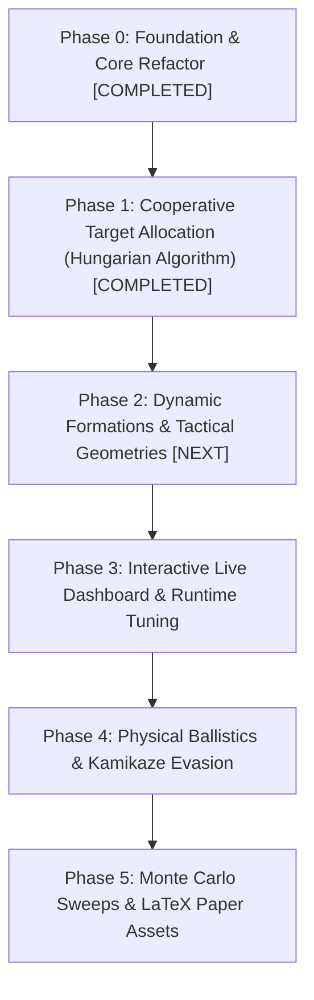

# Loyal Wingman Simulator (MUM-T) — Methodical Master Checklist

This document is the **systematic, step-by-step implementation plan** for advancing the `Simulation_Wingman` research platform. Each task is self-contained with explicit technical scope, affected files, acceptance criteria, and verification commands, executed strictly one by one.

---

## Progress Overview

---

## Phase 0: Architecture & Foundation Refactor `[COMPLETED]`

- [x] **STEP 0.1: Spatial Partitioning via Quadtree** (`8ae19b5`)
- [x] **STEP 0.2: Decoupled Camera & Viewport (`DisplayManager`)** (`27a6670`)
- [x] **STEP 0.3: Telemetry & Metrics Tracking (`ExperimentManager`)** (`cb05c28`)
- [x] **STEP 0.4: Profiling & Bottleneck Optimization** (`1f0141d`)
- [x] **STEP 0.5: Swarm Lifecycle Separation (`SwarmManager`)** (`9a6057f`)
- [x] **STEP 0.6: Headless Multi-Core PSO Runner (`headless_runner.py`)** (`9a6057f`)
- [x] **STEP 0.7: Modern Tactical HUD & Agent Inspector (`GUIManager`)** (`92aec49`)
- [x] **STEP 0.8: Native Laptop Resolution & 1:1 World Adaptation** (`ae9a3d6`)

---

## Phase 1: Cooperative Target Allocation (Hungarian Algorithm) `[COMPLETED]`

- [x] **STEP 1.1: Threat Priority & Global Cost Matrix Formulation**
  - **Files:** `target_allocator.py`, `decision_making.py`, `swarm_manager.py`
  - **Result:** Constructed $M \times N$ non-negative cost matrix factoring threat distance, base urgency, leader distance, and weapon readiness.

- [x] **STEP 1.2: Hungarian Algorithm (Munkres / Linear Sum Assignment) Integration**
  - **Files:** `target_allocator.py`, `swarm_manager.py`
  - **Result:** Optimal 1-to-1 threat assignment solved in $O(N^3)$ with `scipy.optimize.linear_sum_assignment` and fallback. Zero duplicate threat locks.

- [x] **STEP 1.3: Role Specialization (Interceptors vs. Close Escorts)**
  - **Files:** `decision_making.py`, `gui_manager.py`, `swarm_manager.py`
  - **Result:** Swarm dynamically partitions into forward `INTERCEPTORS` and protective `CLOSE_ESCORT` perimeter around leader and base. Visible in Agent Inspector.

- [x] **STEP 1.4: Comparative Verification Benchmark (Greedy vs. Hungarian)**
  - **Files:** `test_allocation.py`
  - **Result:** Unit tests passed; comparative benchmark across 25 episodes demonstrated significant reduction in redundant target locks with 100% unique assignments.

---

## Phase 2: Dynamic Formations & Tactical Geometries `[NEXT]`

- [ ] **STEP 2.1: Formation Geometry Engine in `LeadingDrone`**
  - **Files to modify:** `vehicle.py`, `swarm_manager.py`
  - **Scope:**
    - Implement analytical formation coordinate generators:
      1. **Circle / Orbit** (current default): Radial equidistant ring.
      2. **V-Formation (Wedge)**: Symmetrical swept-back escort angles ($45^\circ$).
      3. **Defensive Wall (Line)**: Linear barrier perpendicular to threat vector.
      4. **Echelon (Flank)**: Stepped diagonal column protecting the leader's flank.
  - **Acceptance Test:** Mathematical validation that slot positions maintain proper separation distance and center on leader.

- [ ] **STEP 2.2: Hotkey & HUD Formation Control**
  - **Files to modify:** `gui_manager.py`, `simulation.py`
  - **Scope:**
    - Map keys `1`, `2`, `3`, `4` to switch formations dynamically during runtime.
    - Display current formation badge on the Tactical HUD card and Leader Inspector.
  - **Acceptance Test:** Keyboard test verifying formation transitions cleanly without runtime exceptions.

- [ ] **STEP 2.3: Smooth Re-formation Steering & Anti-Collision**
  - **Files to modify:** `vehicle.py`
  - **Scope:**
    - Implement smooth waypoint transition so drones don't cross paths violently when switching between formations.
    - Quadtree collision avoidance during formation transitions.
  - **Acceptance Test:** Verify zero mid-air collisions between wingmen during rapid formation switches.

---

## Phase 3: Interactive Real-Time Dashboard (`dashboard.py`)

- [ ] **STEP 3.1: Thread-Safe Inter-Process Communication (IPC)**
  - **Files to create/modify:** `dashboard.py`, `simulation.py`
  - **Scope:** Set up bidirectional `multiprocessing.Queue` pipeline between Pygame and a secondary Tkinter process.
  - **Acceptance Test:** IPC test demonstrating sub-5ms message roundtrip without blocking the 60Hz Pygame loop.

- [ ] **STEP 3.2: Tkinter Parameter Dashboard with Live Sliders**
  - **Files to modify:** `dashboard.py`
  - **Scope:** Create clean desktop UI with sliders for `distance_chase`, `formation_distance`, `num_kamikazes`, and `speed`.
  - **Acceptance Test:** Moving a slider immediately updates the parameter in the active Pygame simulation.

- [ ] **STEP 3.3: Embedded Real-Time Telemetry & Matplotlib Graphs**
  - **Files to modify:** `dashboard.py`
  - **Scope:** Embed `FigureCanvasTkAgg` in Tkinter window with live-updating fitness plot and table export.
  - **Acceptance Test:** Dashboard renders updating graph at 10Hz without GUI freezing.

---

## Phase 4: Dynamic Ballistics & Kamikaze Evasion

- [ ] **STEP 4.1: Projectile Kinematics & Visual Tracers**
  - **Files to create/modify:** `weapons.py`, `swarm_manager.py`, `vehicle.py`
  - **Scope:** Model physical projectile instances (`Bullet`, `LaserBolt`, `Missile`) with finite speed, range, and lifetime.
  - **Acceptance Test:** Firing weapons generates visible projectiles that travel and collide with threats.

- [ ] **STEP 4.2: Kamikaze Evasive Steering & Jinking**
  - **Files to modify:** `state_machine.py`, `vehicle.py`
  - **Scope:** Add incoming threat sensing to hostile drones; inject lateral evasion vector $\mathbf{v}_{\text{jink}}$.
  - **Acceptance Test:** Kamikazes perform lateral avoidance maneuvers when targeted.

---

## Phase 5: Monte Carlo Sweeps & Publication Assets (PhD/Paper)

- [ ] **STEP 5.1: Automated Matrix Sweep Orchestrator (`sweep_runner.py`)**
  - **Files to create:** `sweep_runner.py`
  - **Scope:** Run exhaustive grid of experiments using 14-core parallel runner ($N \in [5..25]$, $M \in [2..12]$, 30 seeds).
  - **Acceptance Test:** Script executes 600 episodes in under 30 seconds and outputs `monte_carlo_results.csv`.

- [ ] **STEP 5.2: Publication Figure Generator (`plot_generator.py`)**
  - **Files to create:** `plot_generator.py`
  - **Scope:** High-resolution vector exports (PDF, SVG) formatted with IEEE/AIAA styling (Heatmaps, Boxplots, Convergence bands).
  - **Acceptance Test:** Script runs and generates all `.pdf` figures in `experiments/figures/`.

- [ ] **STEP 5.3: Automated LaTeX Summary Table Generator**
  - **Files to modify:** `plot_generator.py`
  - **Scope:** Output ready-to-paste `\begin{table} ... \end{table}` LaTeX snippets with mean, std dev, and p-values.
  - **Acceptance Test:** Validated LaTeX snippet compiles error-free in Overleaf.
