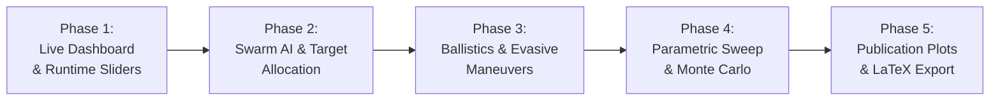

# Loyal Wingman Simulator (MUM-T) — Improvement Roadmap & Checklist

This roadmap defines the next technical milestones for the **Simulation_Wingman** multi-UAV combat simulator, supporting research, simulation fidelity, and publication in scientific venues.

---

## 1. Executive Summary & Goals

The simulator has successfully established:
- Spatial partitioning via **Quadtree** ($O(N \log N)$ complexity).
- Decoupled **SwarmManager** architecture.
- Full 14-core headless multiprocessing runner for **PSO** (Particle Swarm Optimization).
- Glassmorphism **Tactical HUD**, radar minimap, and interactive agent inspector.
- Adaptive 1:1 window resolution matching laptop displays.

The next phases focus on **Swarm Coordination AI**, **Runtime Control (Dashboard)**, **Ballistic Physics**, and **Large-Scale Monte Carlo Evaluation** for paper publication.

---

## 2. Structured Improvement Checklist

### Phase 1: Real-Time Dashboard & Interactive Parameter Tuning
*Goal: Port and expand the Tkinter multi-process dashboard from Search_Drone_Swarms to allow live parameter tuning without restarting.*

- [ ] **1.1. Multiprocessing Telemetry Pipeline**
  - [ ] Implement `multiprocessing.Queue` pipeline between `Simulation` and background UI process.
  - [ ] Send high-frequency telemetry snapshots (simulation time, active units, base HP, FPS, kill counts).
- [ ] **1.2. Interactive Tkinter Dashboard (`dashboard.py`)**
  - [ ] Real-time metric indicators (current generation, active run, fitness, mission status).
  - [ ] Parameter adjustment sliders:
    - [ ] `distance_chase` (Threat engagement radius: $10 - 1000\text{px}$).
    - [ ] `distance_formation` (Escort distance from leader: $20 - 400\text{px}$).
    - [ ] `num_kamikazes` & `kamikaze_speed` multiplier.
  - [ ] Run history table with exportable iteration logs.
  - [ ] Embedded Matplotlib live convergence curve (fitness vs. iteration).

---

### Phase 2: Swarm Coordination AI & Target Allocation
*Goal: Upgrade individual greedy threat selection to cooperative swarm intelligence.*

- [ ] **2.1. Cooperative Target Allocation (Hungarian Algorithm / Auction)**
  - [ ] Replace greedy closest-threat selection in `ChaseThreatNode` with global cost-matrix solver.
  - [ ] Formulate bipartite matching: $C_{ij} = \alpha \cdot \text{dist}(\text{Wingman}_i, \text{Threat}_j) + \beta \cdot \text{dist}(\text{Threat}_j, \text{Base})$.
  - [ ] Prevent redundant targeting (eliminates 3+ wingmen attacking 1 enemy while others penetrate defense).
- [ ] **2.2. Dynamic Tactical Formations**
  - [ ] Implement formation switching for `LeadingDrone`:
    - [ ] Circular/Elliptical escort (current default).
    - [ ] **V-Formation (Wedge)**: Forward defensive wedge.
    - [ ] **Line / Wall**: Lateral barrier shielding the protected base.
    - [ ] **Echelon / Column**: Flank protection during traversal.
  - [ ] Add HUD toggle hotkeys (`F1`-`F4`) and inspector buttons to switch formations on the fly.

---

### Phase 3: Dynamic Ballistics & Evasive Maneuvers
*Goal: Transition from instant probabilistic rolls to physical combat interactions.*

- [ ] **3.1. Physical Projectile & Directed Weapon Systems**
  - [ ] Model physical bullet/missile kinematic entities with finite velocities and lifetime.
  - [ ] Add visual tracers for Freezing beams and Vaporizer railguns.
  - [ ] Implement Quadtree raycast / sphere collision checks for projectile interception.
- [ ] **3.2. Kamikaze Evasive Behaviors**
  - [ ] Add threat perception sensor to hostile kamikazes.
  - [ ] Implement evasion steering: lateral jinking maneuvers when wingmen are within firing range.
  - [ ] Add decoy deployment or feint attacks against the leading drone to draw escorts away from base.

---

### Phase 4: Automated Parametric Sweeps & Monte Carlo Validation
*Goal: Leverage the 14-core headless runner for exhaustive sensitivity analysis and thesis experiments.*

- [ ] **4.1. Parametric Grid-Search Runner (`sweep_runner.py`)**
  - [ ] Matrix testing across independent variables:
    - Escort swarm size: $N \in [5, 10, 15, 20, 25]$.
    - Threat count: $M \in [2, 4, 6, 8, 12, 16]$.
    - Engagement radius: $R_{\text{chase}} \in [100, 300, 500, 700, 900]$.
  - [ ] Monte Carlo execution with multiple random seeds ($K=30$ runs per configuration) for statistical significance.
- [ ] **4.2. Statistical Aggregation**
  - [ ] Export consolidated CSV with confidence intervals, base survival probability, and mean interception latency.

---

### Phase 5: Scientific Reporting & Publication Assets
*Goal: Produce publication-ready figures for LaTeX/Overleaf integration.*

- [ ] **5.1. Publication Plotting Module (`plot_generator.py`)**
  - [ ] IEEE/AIAA style matplotlib theme (serif fonts, vector SVG/PDF export).
  - [ ] Convergence plots with shaded $\pm 1\sigma$ standard deviation bands.
  - [ ] 2D Heatmaps of Base Survival Rate vs. Swarm Density.
  - [ ] Boxplots of mission completion time under varying threat levels.
- [ ] **5.2. Automated LaTeX Summary Table Generator**
  - [ ] Script to output ready-to-paste `\begin{table}` code containing experiment results.

---

## 3. Recommended Implementation Order

| Priority | Task | Complexity | Impact |
| :--- | :--- | :---: | :---: |
| **High** | **Phase 2.1: Target Allocation (Hungarian Algorithm)** | Medium | Fixes critical operational redundancy in defense |
| **High** | **Phase 1: Interactive Dashboard (`dashboard.py`)** | Medium | Instant visual experimentation and demo tool |
| **Medium**| **Phase 4: Parametric Sweeps & Monte Carlo** | Low/Medium | Directly produces empirical data for the PhD thesis |
| **Medium**| **Phase 2.2: Dynamic Formations (V, Wall, Escort)** | Medium | Enhances tactical MUM-T realism |
| **Low** | **Phase 3: Ballistics & Evasion** | High | Visual fidelity and complex micro-mechanics |
