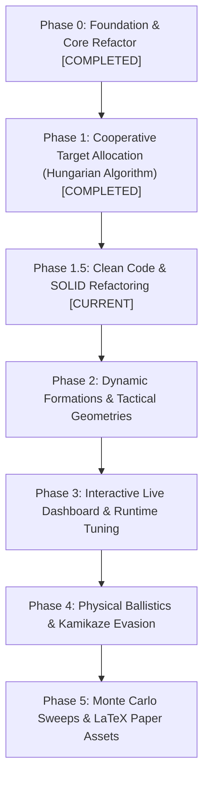

# Loyal Wingman Simulator (MUM-T) — Methodical Master Checklist

This document is the **systematic, step-by-step implementation plan** for advancing the `Simulation_Wingman` research platform. Each task is self-contained with explicit technical scope, affected files, acceptance criteria, and verification commands, executed strictly one by one.

---

## Progress Overview

---

## Phase 0: Architecture & Foundation Refactor `[COMPLETED]`

- [x] **STEP 0.1: Spatial Partitioning via Quadtree** (`8ae19b5`)
- [x] **STEP 0.2: Decoupled Camera & Viewport (`DisplayManager`)** (`27a6670`)
- [x] **STEP 0.3: Telemetry & Metrics Tracking (`ExperimentManager`)** (`cb05c28`)
- [x] **STEP 0.4: Profiling & Bottleneck Optimization** (`1f0141d`)
- [x] **STEP 0.5: Swarm Lifecycle Separation (`SwarmManager`)** (`9a6057f`)
- [x] **STEP 0.6: Headless Multi-Core PSO Runner (`headless_runner.py`)** (`9a6057f`)
- [x] **STEP 0.7: Modern Tactical HUD & Agent Inspector (`GUIManager`)** (`92aec49`)
- [x] **STEP 0.8: Native Laptop Resolution & 1:1 World Adaptation** (`ae9a3d6`)

---

## Phase 1: Cooperative Target Allocation (Hungarian Algorithm) `[COMPLETED]`

- [x] **STEP 1.1: Threat Priority & Global Cost Matrix Formulation** (`1fb222b`)
- [x] **STEP 1.2: Hungarian Algorithm (Munkres / Linear Sum Assignment) Integration** (`1fb222b`)
- [x] **STEP 1.3: Role Specialization (Interceptors vs. Close Escorts)** (`1fb222b`)
- [x] **STEP 1.4: Comparative Verification Benchmark (Greedy vs. Hungarian)** (`1fb222b`)

---

## Phase 1.5: Clean Code & SOLID Overhaul `[CURRENT]`

*Objective: Eliminate technical debt, fix LSP/DIP violations, eliminate duplicated code, and remove hundreds of lines of legacy dead code.*

- [ ] **STEP CC.1: Weapon Polymorphism & Exception Safety (`weapons.py`) [LSP & Clean Code]**
  - **Files:** `weapons.py`, `vehicle.py`, `decision_making.py`
  - **Scope:**
    - Fix Liskov Substitution Principle (LSP): unify `fire(...)` signature across `Weapon`, `Vaporizer`, and `Freezing` (`def fire(self, target_entity=None) -> bool`).
    - Remove bare `except:` blocks; replace with targeted exception handling (`except IndexError:`).
    - Remove Portuguese console prints (`atirei`, `carregando`).
  - **Acceptance Test:** Test script firing weapons with both valid and invalid targets, asserting polymorphic behavior without exceptions.

- [ ] **STEP CC.2: State Machine Consolidation (DRY & SRP in `state_machine.py`)**
  - **Files:** `state_machine.py`, `vehicle.py`, `swarm_manager.py`
  - **Scope:**
    - Unify 95% identical duplicated classes (`AttackLeaderState`, `AttackLoyalWingmanState`, `AttackProtectedAreaState`) into a single extensible `AttackState(target_provider)`.
    - Eliminate dead patrol states (`OvalState`, `EightState`, `Eight2State`) or move them to clean waypoint controllers.
    - Standardize all state transition probabilities into a clean dispatch map.
  - **Acceptance Test:** Verify Kamikazes transition correctly into attacks on Leader, Wingmen, and Base using the unified state class.

- [ ] **STEP CC.3: Decouple Kinematics from Rendering & Dead Code Removal in `vehicle.py` [SRP & ISP]**
  - **Files:** `vehicle.py`, `swarm_manager.py`
  - **Scope:**
    - Strip embedded `pygame.draw.*` calls from pure physics loops in `vehicle.py`.
    - Delete >300 lines of dead commented-out tuning code (`# kp = 0.0024`, `# kv = 800`, etc.).
    - Fix typo naming throughout the class (`coordenates` -> `coordinates`).
    - Replace magic numbers with named constants (`DAMPING_RATIO = 0.9`, `NATURAL_FREQ = 15.0 / 60.0`).
  - **Acceptance Test:** Zero drawing code executed when `window=None`; full regression test confirms physics and collision avoidance remain identical.

- [ ] **STEP CC.4: Nomenclature & Language Standardization (`decision_making.py`)**
  - **Files:** `decision_making.py`
  - **Scope:**
    - Translate Portuguese names (`SequenciaEsquerda` -> `EngagementSequenceNode`, `time_executing` comments).
    - Remove bare `except:` and dead code blocks.
  - **Acceptance Test:** Behavior Tree executes cleanly with 100% English docstrings and symbol names.

- [ ] **STEP CC.5: Complete Regression & Benchmarking Verification**
  - **Files:** `test_allocation.py`, `main.py`
  - **Scope:**
    - Run unit tests, headless parallel PSO, and GUI interactive simulation to confirm 100% behavioral equivalence with cleaner code.
  - **Acceptance Test:** All tests exit with code 0.

---

## Phase 2: Dynamic Formations & Tactical Geometries

- [ ] **STEP 2.1: Formation Geometry Engine in `LeadingDrone` (Strategy Pattern)**
- [ ] **STEP 2.2: Hotkey & HUD Formation Control**
- [ ] **STEP 2.3: Smooth Re-formation Steering & Anti-Collision**

---

## Phase 3: Interactive Real-Time Dashboard (`dashboard.py`)

- [ ] **STEP 3.1: Thread-Safe Inter-Process Communication (IPC)**
- [ ] **STEP 3.2: Tkinter Parameter Dashboard with Live Sliders**
- [ ] **STEP 3.3: Embedded Real-Time Telemetry & Matplotlib Graphs**

---

## Phase 4: Dynamic Ballistics & Kamikaze Evasion

- [ ] **STEP 4.1: Projectile Kinematics & Visual Tracers**
- [ ] **STEP 4.2: Kamikaze Evasive Steering & Jinking**

---

## Phase 5: Monte Carlo Sweeps & Publication Assets (PhD/Paper)

- [ ] **STEP 5.1: Automated Matrix Sweep Orchestrator (`sweep_runner.py`)**
- [ ] **STEP 5.2: Publication Figure Generator (`plot_generator.py`)**
- [ ] **STEP 5.3: Automated LaTeX Summary Table Generator**
