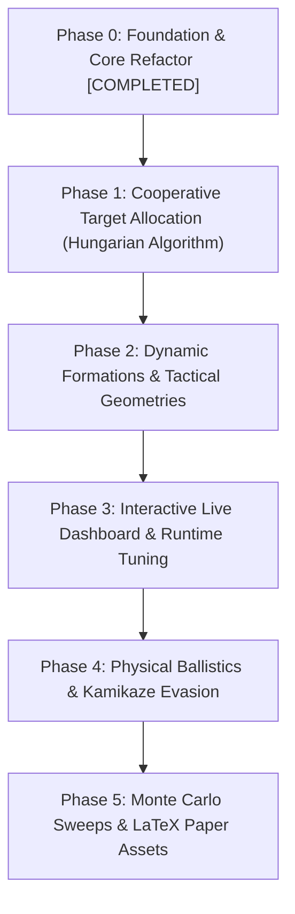

# Loyal Wingman Simulator (MUM-T) — Methodical Master Checklist

This document is the **systematic, step-by-step implementation plan** for advancing the `Simulation_Wingman` research platform. Each task is self-contained with explicit technical scope, affected files, acceptance criteria, and verification commands, executed strictly one by one.

---

## Progress Overview

---

## Phase 0: Architecture & Foundation Refactor `[COMPLETED]`

- [x] **STEP 0.1: Spatial Partitioning via Quadtree**
  - **Files:** `quadtree.py`, `vehicle.py`, `simulation.py`
  - **Result:** Replaced $O(N^2)$ checks with $O(N \log N)$ spatial queries for flocking, threat checks, and collision avoidance.
  - **Commit:** `8ae19b5`

- [x] **STEP 0.2: Decoupled Camera & Viewport (`DisplayManager`)**
  - **Files:** `display_manager.py`, `simulation.py`
  - **Result:** Mouse wheel zoom, middle-click pan, center on leader (`C`), reset view (`0`), screen-to-world coordinate translation.
  - **Commit:** `27a6670`

- [x] **STEP 0.3: Telemetry & Metrics Tracking (`ExperimentManager`)**
  - **Files:** `experiment_manager.py`, `simulation.py`
  - **Result:** Iteration history tracking, CSV logging (`result.csv`), and safe matplotlib export.
  - **Commit:** `cb05c28`

- [x] **STEP 0.4: Profiling & Bottleneck Optimization**
  - **Files:** `utils.py`, `display_manager.py`, `animation.py`
  - **Result:** Removed `copy.deepcopy` bottlenecks, pre-scaled sprite rotations, added font caching. Loop speedup of **2.55x**.
  - **Commit:** `1f0141d`

- [x] **STEP 0.5: Swarm Lifecycle Separation (`SwarmManager`)**
  - **Files:** `swarm_manager.py`, `simulation.py`, `vehicle.py`
  - **Result:** Encapsulated multi-UAV combat logic, lifecycle, and mission termination checks into a GUI-agnostic manager.
  - **Commit:** `9a6057f`

- [x] **STEP 0.6: Headless Multi-Core PSO Runner (`headless_runner.py`)**
  - **Files:** `headless_runner.py`, `main.py`
  - **Result:** 14-core parallel simulation execution (~46ms per full combat episode), macOS `spawn` safety.
  - **Commit:** `9a6057f`

- [x] **STEP 0.7: Modern Tactical HUD & Agent Inspector (`GUIManager`)**
  - **Files:** `gui_manager.py`, `display_manager.py`, `simulation.py`
  - **Result:** Glassmorphism telemetry card, interactive radar minimap, clickable in-world agent selection with live AI status.
  - **Commit:** `92aec49`

- [x] **STEP 0.8: Native Laptop Resolution & 1:1 World Adaptation**
  - **Files:** `constants.py`, `display_manager.py`, `gui_manager.py`, `swarm_manager.py`
  - **Result:** Auto-detection of laptop display ($1658 \times 1017$), 1:1 world fill with zero letterboxing, dynamic window resizing.
  - **Commit:** `ae9a3d6`

---

## Phase 1: Cooperative Target Allocation (Hungarian Algorithm)

*Problem: Currently, wingmen pick threats independently using a greedy heuristic. Multiple wingmen frequently chase the same kamikaze, leaving other lanes unguarded.*

- [ ] **STEP 1.1: Threat Priority & Global Cost Matrix Formulation**
  - **Files to modify:** `decision_making.py`, `swarm_manager.py`
  - **Scope:** 
    - Construct an $M \times N$ cost matrix where $M = \text{number of active Loyal Wingmen}$ and $N = \text{number of active Kamikazes}$.
    - Cost function: $C_{ij} = w_d \cdot \|\mathbf{p}_{\text{wingman}, i} - \mathbf{p}_{\text{kamikaze}, j}\| + w_b \cdot \|\mathbf{p}_{\text{kamikaze}, j} - \mathbf{p}_{\text{base}}\| - w_w \cdot \text{ammo}_i$.
  - **Acceptance Test:** Test script verifying that matrix computes valid non-negative costs and penalizes threats close to the base.

- [ ] **STEP 1.2: Hungarian Algorithm (Munkres / Linear Sum Assignment) Integration**
  - **Files to modify:** `swarm_manager.py`, `decision_making.py`
  - **Scope:**
    - Use `scipy.optimize.linear_sum_assignment` (with pure-Python fallback) to solve the optimal assignment in $O(N^3)$ every $T_{\text{reassign}}$ interval (e.g., every 0.25 seconds or when threats change).
    - Assign unique target handles to each wingman's behavior tree.
  - **Acceptance Test:** Unit test with 4 wingmen and 4 kamikazes verifying each wingman receives a distinct target with zero duplicate targeting.

- [ ] **STEP 1.3: Role Specialization (Interceptors vs. Close Escorts)**
  - **Files to modify:** `decision_making.py`, `vehicle.py`
  - **Scope:**
    - Dynamically partition the swarm: 60% assigned as forward interceptors, 40% reserved as close-in escorts around the Leading Drone and Protected Area.
    - If no threats remain in an interceptor's sector, automatically fall back into escort formation.
  - **Acceptance Test:** Simulation check verifying that at least 2 wingmen always maintain defensive escort radius around the leader.

- [ ] **STEP 1.4: Comparative Verification Benchmark (Greedy vs. Hungarian)**
  - **Files to create/modify:** `test_allocation.py`, `experiment_manager.py`
  - **Scope:**
    - Run 50 headless episodes with Greedy targeting vs. 50 episodes with Hungarian targeting.
    - Measure base survival rate, kill latency, and redundant target locks.
  - **Acceptance Test:** Automated report showing statistically significant reduction in duplicate engagements and increase in base survival.

---

## Phase 2: Dynamic Formations & Tactical Geometries

- [ ] **STEP 2.1: Formation Geometry Engine in `LeadingDrone`**
  - **Files to modify:** `vehicle.py`, `swarm_manager.py`
  - **Scope:**
    - Implement analytical formation coordinate generators:
      1. **Circle / Orbit** (current default): Radial equidistant ring.
      2. **V-Formation (Wedge)**: Symmetrical swept-back escort angles ($45^\circ$).
      3. **Defensive Wall (Line)**: Linear barrier perpendicular to threat vector.
      4. **Echelon (Flank)**: Stepped diagonal column protecting the leader's flank.
  - **Acceptance Test:** Mathematical validation that slot positions maintain proper separation distance and center on leader.

- [ ] **STEP 2.2: Hotkey & HUD Formation Control**
  - **Files to modify:** `gui_manager.py`, `simulation.py`
  - **Scope:**
    - Map keys `1`, `2`, `3`, `4` to switch formations dynamically during runtime.
    - Display current formation badge on the Tactical HUD card and Leader Inspector.
  - **Acceptance Test:** Keyboard test verifying formation transitions cleanly without runtime exceptions.

- [ ] **STEP 2.3: Smooth Re-formation Steering & Anti-Collision**
  - **Files to modify:** `vehicle.py`
  - **Scope:**
    - Implement smooth waypoint transition so drones don't cross paths violently when switching between formations.
    - Quadtree collision avoidance during formation transitions.
  - **Acceptance Test:** Verify zero mid-air collisions between wingmen during rapid formation switches.

---

## Phase 3: Interactive Real-Time Dashboard (`dashboard.py`)

- [ ] **STEP 3.1: Thread-Safe Inter-Process Communication (IPC)**
  - **Files to create/modify:** `dashboard.py`, `simulation.py`
  - **Scope:**
    - Set up bidirectional `multiprocessing.Queue` or `Pipe` between Pygame and a secondary Tkinter process.
    - Outbound queue: simulation stats (time, FPS, units alive, base HP, current quality).
    - Inbound queue: parameter mutations requested by user sliders.
  - **Acceptance Test:** IPC test demonstrating sub-5ms message roundtrip without blocking the 60Hz Pygame loop.

- [ ] **STEP 3.2: Tkinter Parameter Dashboard with Live Sliders**
  - **Files to modify:** `dashboard.py`
  - **Scope:**
    - Create clean native desktop UI with sliders:
      - `distance_chase`: Slider $[50 - 1000]\text{px}$.
      - `distance_formation`: Slider $[30 - 300]\text{px}$.
      - `num_kamikazes`: Slider $[1 - 12]$ (triggers dynamic reinforcements).
      - `accelerated_factor`: Slider $[1 - 20]\text{x}$.
  - **Acceptance Test:** Moving a slider immediately updates the parameter in the active Pygame simulation.

- [ ] **STEP 3.3: Embedded Real-Time Telemetry & Matplotlib Graphs**
  - **Files to modify:** `dashboard.py`
  - **Scope:**
    - Embed `FigureCanvasTkAgg` in Tkinter window.
    - Live-updating plot of quality/fitness and base HP over iterations.
    - Export button to save live telemetry table directly to CSV.
  - **Acceptance Test:** Dashboard renders updating graph at 10Hz without GUI freezing.

---

## Phase 4: Dynamic Ballistics & Kamikaze Evasion

- [ ] **STEP 4.1: Projectile Kinematics & Visual Tracers**
  - **Files to create/modify:** `weapons.py`, `swarm_manager.py`, `vehicle.py`
  - **Scope:**
    - Model physical projectile instances (`Bullet`, `LaserBolt`, `Missile`) with finite speed, range, and lifetime.
    - Replace instant deletion with ballistic time-of-flight and Quadtree hit-box detection.
  - **Acceptance Test:** Firing weapons generates visible projectiles that travel and collide with threats.

- [ ] **STEP 4.2: Kamikaze Evasive Steering & Jinking**
  - **Files to modify:** `state_machine.py`, `vehicle.py`
  - **Scope:**
    - Add incoming threat sensing to hostile drones.
    - When a wingman is within $150\text{px}$ and aligned on threat bearing, inject perpendicular evasion vector $\mathbf{v}_{\text{jink}}$.
  - **Acceptance Test:** Kamikazes perform lateral avoidance maneuvers when targeted.

---

## Phase 5: Monte Carlo Sweeps & Publication Assets (PhD/Paper)

- [ ] **STEP 5.1: Automated Matrix Sweep Orchestrator (`sweep_runner.py`)**
  - **Files to create:** `sweep_runner.py`
  - **Scope:**
    - Run exhaustive grid of experiments using 14-core parallel runner:
      - Wingman count $N \in [5, 10, 15, 20]$.
      - Threat count $M \in [2, 4, 6, 8, 10]$.
      - Seeds $S = 30$ per cell (Total: $4 \times 5 \times 30 = 600$ full combat episodes).
  - **Acceptance Test:** Script executes 600 episodes in under 30 seconds and outputs `monte_carlo_results.csv`.

- [ ] **STEP 5.2: Publication Figure Generator (`plot_generator.py`)**
  - **Files to create:** `plot_generator.py`
  - **Scope:**
    - High-resolution vector exports (PDF, SVG, 300 DPI PNG) formatted with IEEE/AIAA styling.
    - Heatmap: Base Survival Probability vs. $(N, M)$.
    - Boxplot: Defense Duration and Interception Range.
    - Shaded Area Plot: PSO Convergence with $\pm 1\sigma$ confidence bands.
  - **Acceptance Test:** Script runs and generates all `.pdf` figures in `experiments/figures/`.

- [ ] **STEP 5.3: Automated LaTeX Summary Table Generator**
  - **Files to modify:** `plot_generator.py`
  - **Scope:**
    - Output ready-to-paste `\begin{table} ... \end{table}` LaTeX snippets with mean, std dev, and p-values.
  - **Acceptance Test:** Validated LaTeX snippet compiles error-free in Overleaf.
