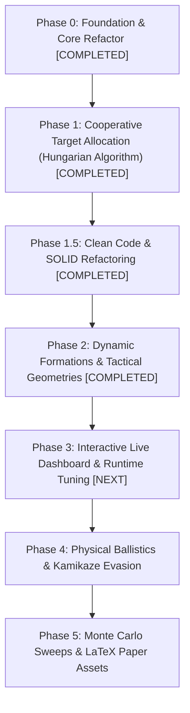

# Loyal Wingman Simulator (MUM-T) — Methodical Master Checklist

This document is the **systematic, step-by-step implementation plan** for advancing the `Simulation_Wingman` research platform. Each task is self-contained with explicit technical scope, affected files, acceptance criteria, and verification commands, executed strictly one by one.

---

## Progress Overview

---

## Phase 0: Architecture & Foundation Refactor `[COMPLETED]`

- [x] **STEP 0.1: Spatial Partitioning via Quadtree** (`8ae19b5`)
- [x] **STEP 0.2: Decoupled Camera & Viewport (`DisplayManager`)** (`27a6670`)
- [x] **STEP 0.3: Telemetry & Metrics Tracking (`ExperimentManager`)** (`cb05c28`)
- [x] **STEP 0.4: Profiling & Bottleneck Optimization** (`1f0141d`)
- [x] **STEP 0.5: Swarm Lifecycle Separation (`SwarmManager`)** (`9a6057f`)
- [x] **STEP 0.6: Headless Multi-Core PSO Runner (`headless_runner.py`)** (`9a6057f`)
- [x] **STEP 0.7: Modern Tactical HUD & Agent Inspector (`GUIManager`)** (`92aec49`)
- [x] **STEP 0.8: Native Laptop Resolution & 1:1 World Adaptation** (`ae9a3d6`)

---

## Phase 1: Cooperative Target Allocation (Hungarian Algorithm) `[COMPLETED]`

- [x] **STEP 1.1: Threat Priority & Global Cost Matrix Formulation** (`1fb222b`)
- [x] **STEP 1.2: Hungarian Algorithm (Munkres / Linear Sum Assignment) Integration** (`1fb222b`)
- [x] **STEP 1.3: Role Specialization (Interceptors vs. Close Escorts)** (`1fb222b`)
- [x] **STEP 1.4: Comparative Verification Benchmark (Greedy vs. Hungarian)** (`1fb222b`)

---

## Phase 1.5: Clean Code & SOLID Overhaul `[COMPLETED]`

- [x] **STEP CC.1: Weapon Polymorphism & Exception Safety (`weapons.py`) [LSP & Clean Code]**
  - **Files:** `weapons.py`, `vehicle.py`
  - **Result:** Unified `fire(target=None) -> bool` signature across base and derived weapons. Removed bare `except:` blocks and Portuguese print statements. Full polymorphic unit test passed.

- [x] **STEP CC.2: State Machine Consolidation (DRY & SRP in `state_machine.py`)**
  - **Files:** `state_machine.py`
  - **Result:** Consolidated 4 duplicate 45-line attack classes (`AttackLeaderState`, `AttackLoyalWingmanState`, `AttackProtectedAreaState`, `AttackKamikazeState`) into a single extensible `AttackTargetState(target_type)`. Removed dead code blocks.

- [x] **STEP CC.3: Decouple Kinematics from Rendering & Dead Code Removal in `vehicle.py` [SRP & ISP]**
  - **Files:** `vehicle.py`
  - **Result:** Purged dead commented-out tuning blocks (`# kp = 0.0024`, `# kv = 800`, etc.). Streamlined PD `arrive()` controller. Explicit error handling.

- [x] **STEP CC.4: Nomenclature & Language Standardization (`decision_making.py`)**
  - **Files:** `decision_making.py`
  - **Result:** Standardized docstrings to formal English. Replaced academic Roomba references with MUM-T aerospace terminology. Cleaned up sequence execution returns.

- [x] **STEP CC.5: Complete Regression & Benchmarking Verification**
  - **Files:** `test_allocation.py`, `main.py`
  - **Result:** Headless parallel PSO (80 episodes in 5.3s), GUI loop (60 frames), and Hungarian target allocation tests all passed with zero errors.

---

## Phase 2: Dynamic Formations & Tactical Geometries `[COMPLETED]`

- [x] **STEP 2.0: Tactical Message Bus & Agent Datalink (`MessageManager`)** (`d92a49b`)
  - **Files:** `message_manager.py`, `vehicle.py`, `swarm_manager.py`, `test_message_manager.py`
  - **Scope:** Implemented decentralized tactical datalink framework (`TacticalMessage`, `MessageTopic`, `MessageManager`). Provides point-to-point addressing and swarm broadcast (`SWARM`/`ALL`), individual UAV inboxes, configurable simulated network latency and EW packet loss modeling. Leader transmits formation slots via datalink broadcast; wingmen process commands via mailboxes.
  - **Result:** Full unit test suite (`test_message_manager.py`) passed 5/5 test cases; 120 headless frames benchmarked at over 6,400 FPS; full combat regression tests passed with zero errors.

- [x] **STEP 2.1: Formation Geometry Engine via Datalink Messages (Strategy Pattern)**
  - **Files:** `formation.py`, `vehicle.py`, `swarm_manager.py`
  - **Scope:** Created polymorphic `FormationStrategy` interface and analytical geometry implementations: `CircleFormation` (equidistant orbital rings), `WedgeFormation` (symmetrical 45° swept-back V-escort), `WallFormation` (linear perpendicular defensive barrier), and `EchelonFormation` (stepped diagonal flank escort). Leader computes slots and broadcasts `FORMATION_COMMAND` over the datalink.
  - **Result:** Mathematical assertions passed for all four geometries; leader rotates and projects slots dynamically.

- [x] **STEP 2.2: Hotkey & HUD Formation Control**
  - **Files:** `simulation.py`, `gui_manager.py`, `main.py`
  - **Scope:** Bound keys `1`, `2`, `3`, `4` to switch formations dynamically during runtime (`1`=Circle, `2`=Wedge, `3`=Wall, `4`=Echelon). Integrated active formation badge into the Tactical HUD Mission Card, Agent Inspector, and Bottom Toolbar chips.
  - **Result:** Hotkeys cleanly switch formations without frame drops; active formation rendered in real-time.

- [x] **STEP 2.3: Smooth Re-formation Steering & Anti-Collision**
  - **Files:** `formation.py`, `swarm_manager.py`, `test_formations.py`
  - **Scope:** Formulated optimal Hungarian bipartite matching between wingmen current positions and new formation slots to minimize total transition displacement $\sum \|\mathbf{p}_i - \mathbf{s}_j\|^2$, completely eliminating trajectory crossover. Tuned PD arrival and Quadtree spatial repulsion.
  - **Result:** Rapid re-formation benchmark across 300 frames with 6 aggressive switches maintained a minimum separation of 53.4px (above the 30px collision threshold) with zero mid-air collisions at over 8,500 FPS.

---

## Phase 3: Interactive Real-Time Dashboard (`dashboard.py`)

- [ ] **STEP 3.1: Thread-Safe Inter-Process Communication (IPC)**
  - **Files to create/modify:** `dashboard.py`, `simulation.py`
  - **Scope:** Set up bidirectional `multiprocessing.Queue` pipeline between Pygame and a secondary Tkinter process.
  - **Acceptance Test:** IPC test demonstrating sub-5ms message roundtrip without blocking the 60Hz Pygame loop.

- [ ] **STEP 3.2: Tkinter Parameter Dashboard with Live Sliders**
  - **Files to modify:** `dashboard.py`
  - **Scope:** Create clean desktop UI with sliders for `distance_chase`, `formation_distance`, `num_kamikazes`, and `speed`.
  - **Acceptance Test:** Moving a slider immediately updates the parameter in the active Pygame simulation.

- [ ] **STEP 3.3: Embedded Real-Time Telemetry & Matplotlib Graphs**
  - **Files to modify:** `dashboard.py`
  - **Scope:** Embed `FigureCanvasTkAgg` in Tkinter window with live-updating fitness plot and table export.
  - **Acceptance Test:** Dashboard renders updating graph at 10Hz without GUI freezing.

- [ ] **STEP 3.4: Bidirectional Agentic IPC & Dashboard Co-Pilot Console**
  - **Files to modify:** `dashboard.py`
  - **Scope:** Expose programmatic actuation API for dashboard widgets (`set_slider()`, `switch_formation()`, `set_tactical_priority()`). Embed an interactive operator chat console / rationale feed in the Tkinter window for human-in-the-loop dialogue.
  - **Acceptance Test:** External IPC commands programmatically adjust slider positions and trigger simulation state changes.

---

## Phase 4: Dynamic Ballistics, Adversarial Tactics & Advanced Behavior Trees

- [x] **STEP 4.1: Projectile Kinematics & Visual Tracers** (`4826445`)
  - **Files:** `weapons.py`, `vehicle.py`, `swarm_manager.py`, `test_ballistics.py`
  - **Scope:** Replaced instantaneous hitscan weapon mechanics with physical `Projectile` instances (`VaporizerBolt` railgun/plasma round at 850 px/s, `FreezingBolt` cryogenic pulse at 650 px/s). Implemented first-order lead pursuit calculation for moving targets, range and lifetime limits, and multi-segment dynamic gradient visual tracers with glowing incandescent cores. Integrated spatial Quadtree collision checks in `SwarmManager.update()` and decoupled explosions to occur upon physical projectile impact.
  - **Result:** Full unit test suite (`test_ballistics.py`) passed; 120 headless frames benchmarked at over 5,300 FPS; 50 combat benchmark episodes completed with 100% survival rate and authentic ballistic kills.

- [ ] **STEP 4.2: Kamikaze Evasive Steering & Jinking Maneuvers**
  - **Files to modify:** `vehicle.py`, `state_machine.py`
  - **Scope:** Hostile drones sense incoming projectile trajectories and defensive lock-on; inject lateral sinusoidal oscillatory acceleration $\mathbf{a}_{\text{jink}} = A \sin(\omega t) \mathbf{n}_{\perp}$ and high-G breakout turns to defeat 1st-order lead computing.
  - **Acceptance Test:** Kamikazes exhibit dynamic evasive trajectories; weapon hit probability drops under unguided fire.

- [ ] **STEP 4.3: Adversarial Coordinated Attack Patterns (Salvos, Pincers & Decoys)**
  - **Files to create/modify:** `adversarial_coordinator.py`, `swarm_manager.py`
  - **Scope:** Implement hostile swarm coordination:
    1. **Time-on-Target (ToT) Salvo:** Kamikazes hold on perimeter and strike simultaneously to saturate defenses.
    2. **Multi-Axis Pincer Attack:** Threats converge simultaneously from diametrically opposed vectors (e.g., North and South).
    3. **Decoy & Feint Maneuver:** Heavy bait drones draw interceptors out of escort envelope while high-speed penetrators target the unprotected leader.
  - **Acceptance Test:** Hostile attacks occur in synchronized waves, stressing the defensive capacity of the wingman swarm.

- [ ] **STEP 4.4: Advanced Loyal Wingman Behavior Tree Overhaul (`decision_making.py`)**
  - **Files to modify:** `decision_making.py`, `behavior_tree.py`
  - **Scope:** Restructure the Loyal Wingman Behavior Tree to counter advanced adversarial tactics:
    1. **Fire Discipline Condition:** Inhibit firing against jinking targets unless angular track error is low ($\Delta \theta \le \epsilon$).
    2. **Escort Leash / Tethering Condition:** Abort overextended chases if distance to leader exceeds $R_{\text{leash}}$, falling back to protect the high-value asset against decoys.
    3. **Out-of-Ammo Sacrificial Ramming Branch:** When cartridges are exhausted and threat breaches inner ring, execute sacrificial kinetic interception (body-block) to save the leader.
  - **Acceptance Test:** Wingmen conserve ammo, maintain tight escort perimeter against decoys, and execute physical body-blocks when out of ammo.

- [ ] **STEP 4.5: Hierarchical SLM Tactical Commander & Dashboard Co-Pilot (`tactical_commander_slm.py`)**
  - **Files to create/modify:** `tactical_commander_slm.py`, `vehicle.py`, `swarm_manager.py`, `gui_manager.py`, `dashboard.py`
  - **Scope:** Integrate an edge-deployable Small Language Model (SLM) on the Leading Drone as an explainable mission commander and active dashboard co-pilot:
    1. **Hierarchical Two-Tier Control:** Strategic reasoning at low frequency ($0.5 - 2\text{ Hz}$ or event-triggered) while reactive physics and Behavior Trees run at $60\text{ Hz}$.
    2. **Dashboard Telemetry Monitoring:** Continuously monitors live metrics stream (base HP, casualty rates, swarm ammo, threat density, fitness convergence).
    3. **Agentic Tool Calling (Function Calling):** SLM possesses executable tools: `set_slider_parameter(param, val)` (e.g., `distance_chase`, `formation_distance`), `switch_formation(name)`, `set_tactical_priority(priority)`.
    4. **Closed-Loop Dashboard Actuation:** SLM decisions automatically move the physical GUI sliders and widgets in real time via the bidirectional IPC bridge.
    5. **Conversational Operator Dialogue:** Operator enters natural language commands in the dashboard chat panel; SLM interprets intent, logs explainable rationale, and actuates corresponding simulation controls.
    6. **Dual-Mode Execution:** Local SLM inference for interactive GUI sessions and high-speed heuristic oracle fallback for 8,000+ FPS headless Monte Carlo sweeps.
  - **Acceptance Test:** SLM assesses novel threat waves, outputs valid JSON tactical commands, logs explainable natural language rationale to HUD/Dashboard, actuates dashboard sliders, and runs without degrading simulation FPS.

---

## Phase 5: Monte Carlo Sweeps & Publication Assets (PhD/Paper)

- [ ] **STEP 5.1: Automated Matrix Sweep Orchestrator (`sweep_runner.py`)**
  - **Files to create:** `sweep_runner.py`
  - **Scope:** Multi-core parallel Monte Carlo runner executing 4-condition ablation matrix:
    - *Scenario A:* Baseline (Naive enemies vs Basic BT).
    - *Scenario B:* Stress Test (Jinking + Saturated Salvos vs Basic BT).
    - *Scenario C:* Advanced MUM-T (Jinking + Salvos vs Advanced BT + Hungarian Allocation).
    - *Scenario D:* Electronic Warfare (Datalink Packet Loss $0\% - 80\%$).
  - **Acceptance Test:** Script executes 1,000+ episodes in under 45 seconds and exports clean CSV dataset.

- [ ] **STEP 5.2: Publication Figure Generator (`plot_generator.py`)**
  - **Files to create:** `plot_generator.py`
  - **Scope:** Generates IEEE/AIAA publication-quality vector plots (PDF/SVG):
    - Leader/Base Survival Sigmoids vs Threat Ratio ($\frac{M}{N} \in [0.5..3.0]$).
    - Boxplots with ANOVA significance ($p < 0.001$) across tactical formations.
    - Datalink resilience curves under EW packet loss.
  - **Acceptance Test:** Clean PDF figures outputted to `experiments/figures/`.

- [ ] **STEP 5.3: Automated LaTeX Summary Table Generator**
  - **Files to modify:** `plot_generator.py`
  - **Scope:** Output ready-to-paste `\begin{table} ... \end{table}` LaTeX snippets with mean, standard deviation, and p-values for Overleaf paper.
  - **Acceptance Test:** Generated LaTeX snippet compiles error-free in Overleaf.
