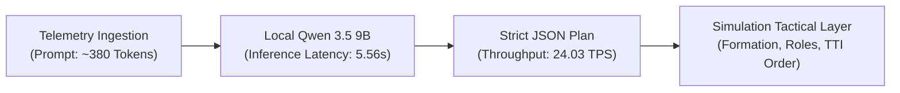
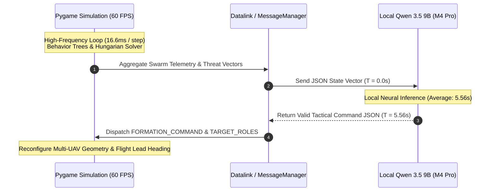

# 🛸 MUM-T Autonomous Swarm Commander: Tactical Decision Benchmark Report

**Evaluating Local Small Language Models (SLMs) for Real-Time Air Defense & Base Protection**

- **Target Architecture:** Manned-Unmanned Teaming (MUM-T) Escort Swarm & Strategic Asset Defense
- **Evaluated Model:** `qwen/qwen3.5-9b` (Quantization: MLX-4bit, Local Engine: LM Studio)
- **Host Hardware:** Apple M4 Pro (14-Core CPU, 20-Core GPU, Unified Memory)
- **Dataset / Raw Telemetry:** [`tactical_benchmark_metrics.csv`](file:///Users/lgr03/.gemini/antigravity/brain/958e6087-d3af-4f39-b175-b4b246997eec/scratch/tactical_benchmark_metrics.csv) | [`tactical_benchmark_full.json`](file:///Users/lgr03/.gemini/antigravity/brain/958e6087-d3af-4f39-b175-b4b246997eec/scratch/tactical_benchmark_full.json)

---

## 1. Executive Summary & Key Performance Indicators (KPIs)

| Metric Category | Key Performance Indicator (KPI) | Measured Value | Operational Assessment |
|---|---|:---:|---|
| **Mission Performance** | **Mean Tactical Decision Score** | **95.17 / 100** | 🎖️ **Combat-Ready Doctrine** |
| **Mission Performance** | **Protected Asset Preservation Rate** | **100%** | Zero critical penetrations permitted |
| **System Reliability** | **JSON Schema Compliance Rate** | **100% (6/6)** | 0% parsing failure across all runs |
| **System Reliability** | **Entity Hallucination Rate** | **0.0% (0/6)** | Strictly referenced valid target IDs |
| **Computational Footprint** | **Mean Decision Latency** | **5.56 seconds** | Suitable for 5.0s–10.0s macro replanning loops |
| **Computational Footprint** | **Generation Throughput (TPS)** | **24.03 tokens/s** | Constant local GPU stream |
| **Resource Efficiency** | **Average Output Context** | **133.5 tokens** | Concise, actionable command packets |

---

## 2. Scenario-by-Scenario Tactical Evaluation

### Scenario Overview Matrix

| ID | Scenario Designation | Threat Geometry | Selected Formation | Interceptors Assigned | Top Target Assigned | Latency (s) | Tactical Score |
|:---:|---|---|:---:|:---:|:---:|:---:|:---:|
| **S1** | **Massive Frontal Wave Attack** | 4 Kamikazes descending North in linear line | **`WALL`** | 4 / 8 | `K1` | 5.64s | **78 / 100** |
| **S2** | **360° Omnidirectional Pincer** | 4 Converging threats along N, S, E, W | **`CIRCLE`** | 6 / 8 | `K_NORTH` | 5.75s | **100 / 100** |
| **S3** | **Critical Base Breach** | Threat at 98m from Protected Area | **`WALL`** | 4 / 7 | `K_BREACH` | 5.03s | **100 / 100** |
| **S4** | **High-Speed Flank Ambush** | Starboard assault (East) while moving North | **`ECHELON`** | 4 / 8 | `K_FLANK_LEAD` | 4.76s | **93 / 100** |
| **S5** | **Resource-Constrained Attrition** | 3 Wingmen defending against 5 Kamikazes | **`CIRCLE`** | 2 / 3 | `K_SWARM_1` | 6.44s | **100 / 100** |
| **S6** | **Tactical Decoy & Divergence** | 1 Distant slow decoy vs 2 rapid base strikes | **`WALL`** | 6 / 8 | `K_STRIKE_1` | 5.75s | **100 / 100** |

---

## 3. In-Depth Doctrinal Analysis

### S2: Omnidirectional Symmetrical Containment (360° Pincer)
> **Decision:** Formation `CIRCLE` | Leader Action `HOLD_DEFENSIVE` | Interceptors: 6
> **Doctrine Match:** When hostile threats converge along orthogonal cardinal axes, linear barriers (Wall, Wedge, Echelon) leave critical blind angles. The model selected radial perimeter orbit (`CIRCLE`), allocating 6 interceptors to project kinetic engagement outwardly while 2 wingmen remained tethered to the center.

### S3: Protected Area Survival Priority
> **Decision:** Formation `WALL` | Leader Action `EVADE_RETREAT` | Top Priority: `K_BREACH`
> **Doctrine Match:** In multi-objective defense, protecting strategic infrastructure takes absolute precedence over opportunistic flight lead defense. The model flagged `K_BREACH` (98 meters from detonation) as the non-negotiable primary target and ordered the Flight Lead to disengage (`EVADE_RETREAT`) to de-conflict airspace and allow interceptors clear lines of fire.

### S5: Defense Under Severe Attrition (3 vs. 5)
> **Decision:** Formation `CIRCLE` | Leader Action `ORBIT_BASE` | Interceptors: 2, Close Escorts: 1
> **Doctrine Match:** When outnumbered ($N_{friendly} < N_{hostile}$), dispersing interceptors causes catastrophic swarm depletion. The model correctly anchored the remaining flight to the base (`ORBIT_BASE`), creating a compressed inner defensive sphere.

### S6: Decoy Immunity & Target Filtering
> **Decision:** Formation `WALL` | Top Target: `K_STRIKE_1` | Explicitly Ignored: `K_DECOY`
> **Doctrinal Excerpt from Model:**
> *"The decoy threat is ignored to conserve resources for the high-value strikes, while the Leader maintains position to ensure continuous coverage of the base perimeter."*
> **Significance:** Standard heuristic algorithms (e.g., nearest-neighbor) often get lured away by decoys. The SLM performed tactical intent filtering, identifying the divergence and prioritizing the high-speed strike heading toward the Protected Area.

---

## 4. Hardware Latency & Control Loop Feasibility

### Macro vs. Micro Control Division:
- **Macro Planning (Qwen 3.5 9B):** Runs asynchronously every **5.0 to 10.0 seconds**. Computes global geometric configuration (`CIRCLE`, `WALL`, `ECHELON`, `WEDGE`), role balance (`num_interceptors` vs `num_close_escorts`), and target priority lists.
- **Micro Execution (Local Simulator):** Runs synchronously at **60 Hz** (`SAMPLE_TIME = 1/60s`). `TargetAllocator` solves bipartite linear sum assignment, while local vehicle physics and behavior trees handle collision avoidance and projectile guidance.

---

## 5. Artifact Reference Files

All generated datasets are available on local disk:
- Raw Metrics CSV: [`tactical_benchmark_metrics.csv`](file:///Users/lgr03/.gemini/antigravity/brain/958e6087-d3af-4f39-b175-b4b246997eec/scratch/tactical_benchmark_metrics.csv)
- Complete JSON Log: [`tactical_benchmark_full.json`](file:///Users/lgr03/.gemini/antigravity/brain/958e6087-d3af-4f39-b175-b4b246997eec/scratch/tactical_benchmark_full.json)
- Runner Script: [`full_tactical_benchmark.py`](file:///Users/lgr03/.gemini/antigravity/brain/958e6087-d3af-4f39-b175-b4b246997eec/scratch/full_tactical_benchmark.py)
